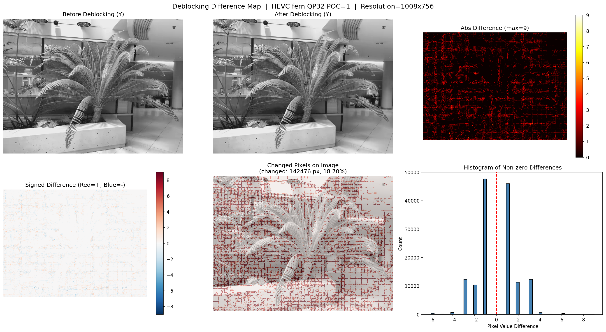
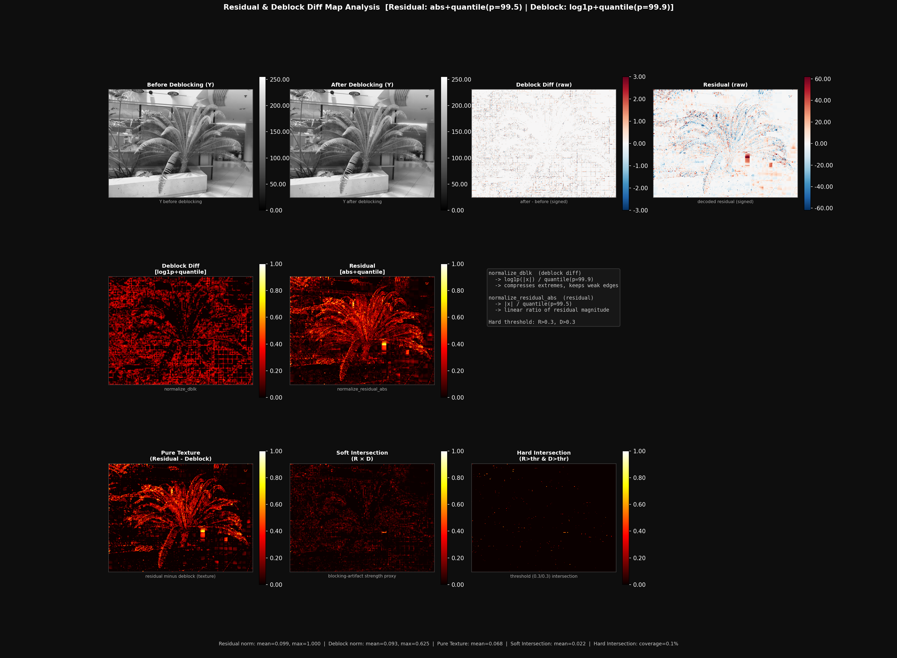
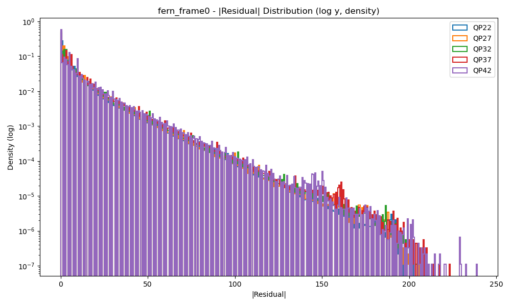
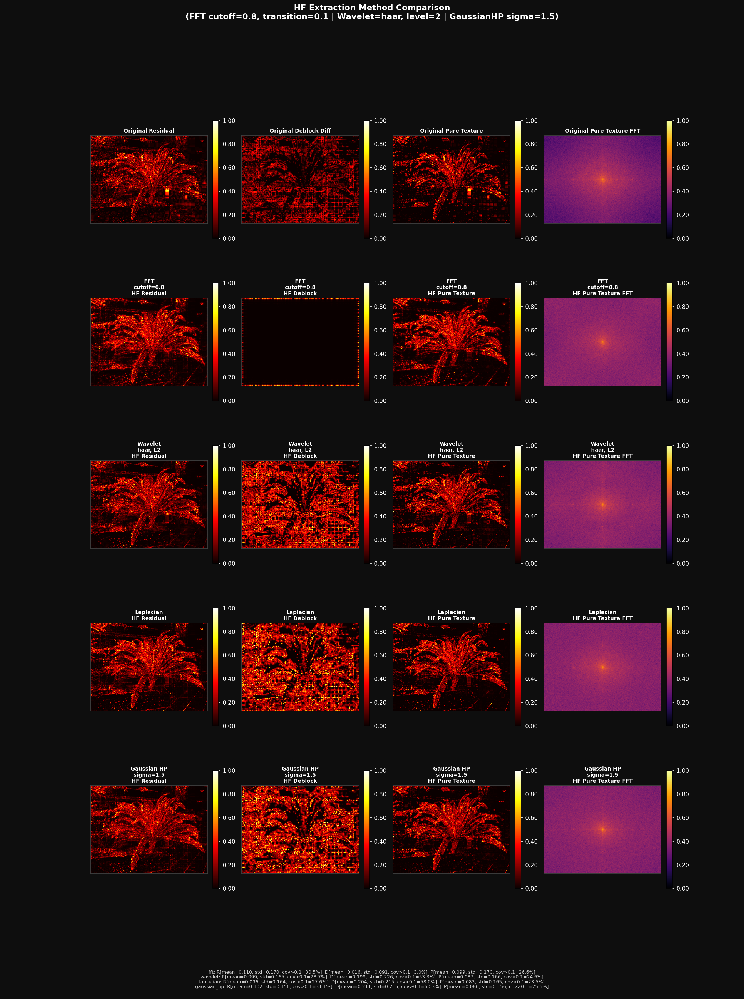

# analysis — residual 과 blocking artifact 의 관계 분석

디코더에서 뽑은 **residual frame** 과 **deblocking 전/후 프레임**을 같은 화면 좌표에서 비교해서,
"residual 이 큰 곳"과 "deblocking filter 가 많이 고친 곳(= blocking artifact 의 대리 지표)"이 어떻게 겹치고 다른지 보는 스크립트 모음이다.
원래 `HM/analysis/` 에서 HEVC(HM) 결과로 작업하던 코드를 정리해 옮겼다. 입력 포맷 규칙은 세 코덱(AVC/HEVC/VVC)을 모두 지원하지만,
아래 결과는 **HEVC 한 시퀀스**에서 나온 것이다.

## 설치

```bash
pip install -r analysis/requirements.txt     # numpy, matplotlib, opencv-python, scipy, PyWavelets
```

스크립트는 레포 루트에서 `python analysis/<script>.py ...` 로 실행한다. 출력은 기본으로 `analysis/outputs/<스크립트>/` 에 쓰고 이 폴더는 `.gitignore` 된다.

## 입력과 공통 인자

모든 스크립트가 같은 인자를 쓴다 (`common/io_utils.py`).

| 인자 | 기본값 | 뜻 |
|---|---|---|
| `--codec` | `HEVC` | `AVC`(JM) / `HEVC`(HM) / `VVC`(VTM). coded 크기와 크롭 규칙이 달라진다 |
| `--width --height` | `1008 756` | **표시(크롭) 크기**. deblock 파일은 coded 크기(HEVC/VVC 8 정렬, AVC 16 정렬)로 읽은 뒤 이 크기로 자른다 |
| `--root` | HEVC: `HM/Compressed/LLFF`, VVC: `VTM/Compressed/LLFF` | `HM.py`/`VTM.py` 출력 루트. AVC 는 기본값이 없어 경로를 직접 준다 |
| `--scene --qp --poc` | `fern 32 1` | `<root>/<CODEC>/<scene>/QP<qp>/{residual,deblock/before,deblock/after}/..._<poc>.yuv` 를 만든다. `poc` 는 파일 번호(= POC+1) |
| `--residual --before --after` | 없음 | 파일 경로를 직접 지정 (위 규칙 무시) |
| `--bit-depth` | `8` | deblock yuv 샘플 비트수. 지금 세 디코더 모두 uint8 로 저장한다 |
| `--out-dir` | `analysis/outputs/<스크립트>` | 출력 위치 |

크기 규칙 (각 코덱 README 참고): residual 은 HEVC/VVC 가 크롭(1008x756), AVC 는 coded(1008x768). deblock 은 세 코덱 모두 coded(HEVC/VVC 1008x760, AVC 1008x768).
**두 맵을 같이 쓰는 스크립트는 항상 둘 다 표시 크기(위쪽/왼쪽 756x1008)로 맞춘 뒤 계산한다.**

## 스크립트

| 스크립트 | 목적 | 입력 | 출력 | 실행 예 |
|---|---|---|---|---|
| `01_deblock_diff.py` | deblocking diff(`after − before`) 6패널 시각화 + 통계(변경 비율, 최대/최소, 값 빈도, 부호, 8px 격자 집중도, PSNR) | before/after | `diff_map_<tag>.png` | `python analysis/01_deblock_diff.py --scene fern --qp 32 --poc 1` |
| `02_deblock_grad_lap.py` | `D=|after−before|` 의 Sobel X/Y, gradient magnitude, Laplacian | before/after | 개별 png 10개 + `<tag>_summary.png` | `python analysis/02_deblock_grad_lap.py --scene fern` |
| `03_residual_visual.py` | residual Y 를 npy(int16)/png + 통계. `--variants` 면 abs/DoG/Sobel/Laplacian/wavelet-high 변형도 | residual (파일 1개 또는 `--residual-dir`) | `<codec>_..._residual_XXXX.{npy,png}`, `*_{signed,abs,dog,sobel,lap,wavehigh}.png` | `python analysis/03_residual_visual.py --scene trex --variants` |
| `04_residual_qp_dist.py` | 한 scene 의 QP 별 residual 히스토그램 overlay (density / log / \|r\| log) + QP 별 통계 | `<root>/<CODEC>/<scene>/QP*/residual/*.yuv` | `<scene>/<scene>_frame0_qp_overlay_*.png` | `python analysis/04_residual_qp_dist.py --scene fern` (`--all-scenes`) |
| `05_residual_deblock_intersection.py` | residual 과 deblock diff 를 정규화·smoothing 한 뒤 soft 교집합(곱), hard 교집합(threshold), 차(pure texture) | residual + before/after | `map_visualization_<tag>.png` (`--save-npy` 면 맵 npy) | `python analysis/05_residual_deblock_intersection.py --scene fern` |
| `06_hf_frequency.py` | residual / deblock / pure texture 의 고주파 성분을 FFT·wavelet·Laplacian·Gaussian-HP 4가지로 추출해 비교 | residual + before/after | `hf_{residual,deblock,pure_texture}_<method>.npy`, `hf_method_comparison_<tag>.png` | `python analysis/06_hf_frequency.py --scene fern` |
| `07_residual_dog_sweep.py` | \|residual\| 의 DoG 파라미터(p, σ1, σ2, γ) sweep, edge 점수와 FFT 격자 점수로 순위 | residual | `<scene>/*_sweep_summary.csv`, `*_TOP<k>/` png | `python analysis/07_residual_dog_sweep.py --scene fern --qp 42` |

`<tag>` = `<CODEC>_<scene>_QP<qp>_poc<XXXX>`. `--root` 를 주지 않으면 `HM/Compressed/LLFF` 를 찾는데, 데이터는 레포에 없으므로 먼저 `HM/HM.py` 로 만들어야 한다.

### 원본 파일과 대응 / 남긴 버전

각 원본 파일에는 예전 버전이 통째로 주석으로 남아 있었다. **활성(주석 아닌) 최신 버전만** 옮겼고 죽은 주석 코드는 지웠다(원본은 `HM/analysis/` 에 그대로 있다. 레포에는 올리지 않음).

| 새 파일 | 원본 | 살린 것 | 지운 주석 코드 |
|---|---|---|---|
| `01_deblock_diff.py` | `deblock_diff.py` | 1–106행 (6패널 `visualize_diff`) | 107–292행: 여러 scene/QP 를 도는 이전 버전 |
| `02_deblock_grad_lap.py` | `deblock_grad.py` | 거의 전부 (설명 주석만 있었음) | 없음 |
| `03_residual_visual.py` | `visual.py` + `resi_dist.py` | `visual.py` 1–99행, `resi_dist.py` 의 `visualize_residual_variants` 계열(467–559행) | `visual.py` 100–309행, `resi_dist.py` 1–268행(`_save_histograms`, `analyze_*` 이전 버전) |
| `04_residual_qp_dist.py` | `resi_dist.py` | `compare_qp_distributions_*`, `plot_qp_overlaid_hists` (269–449행). 주석으로만 남아 있던 호출 예(leaves)는 CLI 인자로 대체 | 위와 같음 |
| `05_residual_deblock_intersection.py` | `visual_diff_resi_deblock.py` | v2 (225–495행, log1p/abs quantile 정규화) | 1–224행: v1 (`normalize_map` percentile 하나로 정규화) |
| `06_hf_frequency.py` | `fft_heat.py` | 1676–2073행 (4가지 HF 방법 비교) | 1–922행: 주파수 band 에너지 시각화, pure texture FFT 강화 버전 / 923–1213행: FFT HF 만 / 1215–1675행: `HF_METHOD` 하나만 고르는 버전 |
| `07_residual_dog_sweep.py` | `DoG_normal.py` | 279–502행 (DoG 파라미터 sweep) | 1–278행: HV edge 억제, FFT notch, morphology 를 쓰는 HF map 버전 |
| `common/io_utils.py` | 위 파일들에 중복돼 있던 함수 | `read_y_channel`, `read_residual_y`, `normalize_dblk`, `normalize_residual_abs`, `normalize_map`, `robust_scale_abs` + 크롭/경로 처리 | — |

### 정리하면서 고친 것

| # | 원본 | 문제 | 수정 |
|---|---|---|---|
| 1 | `deblock_diff.py` | 8-bit 데이터인데 PSNR peak = 1023, 패널 5 `imshow(vmax=1023)` | `--bit-depth` 로 peak = 2^b−1. fern QP32 POC1 PSNR 이 62.40 dB(peak 1023) → **50.34 dB**(peak 255, 760행 기준)로 바뀜 |
| 2 | `deblock_diff.py` 등 | 기본 HEIGHT 가 760(coded)과 756(크롭)으로 섞여 있음 | deblock 은 coded 크기로 읽고 표시 크기로 크롭. coded 전체로 보려면 `01 --no-crop` |
| 3 | `resi_dist.py`, `DoG_normal.py` | residual(Y 만 저장)을 읽을 때 프레임 크기를 Y+Cb+Cr 로 계산 → `frame_index>0` 이면 위치가 틀림 | Y plane 크기로 seek (`read_residual_y`) |
| 4 | `deblock_grad.py` | 760행 파일을 756행 기준 프레임 크기로 seek → `frame_index>0` 이면 틀림 | coded 크기로 seek 후 크롭 |
| 5 | `visual_diff_resi_deblock.py` | `codec="VVC"` 면 deblock 을 uint16 으로 읽음. 현재 VTM 디코더는 uint8 로 저장 | 비트수는 `--bit-depth` 로만 결정 (기본 8) |
| 6 | `visual_diff_resi_deblock.py` | before/after 패널을 `vmax=1` 로 그려 0..255 영상이 흰색으로 포화 | `vmax = peak` |
| 7 | `visual_diff_resi_deblock.py` | 그림 라벨의 한글이 기본 폰트(DejaVu)에 없어 깨짐 | 그림 라벨만 영어로 |
| 8 | 전체 | 하드코딩된 경로·해상도·POC·scene·QP, `plt.show()` | argparse 인자, 상대경로 기본값, `analysis/outputs/` 저장, `--show` 일 때만 창 표시 |
| 9 | 전체 | AVC(JM) residual 은 크롭 안 된 768행 | `--codec AVC` 면 크롭 |
| 10 | `visual.py` | 디버그 `print('check')` | 제거 |

그 밖의 계산(정규화 분위수, smoothing σ, threshold, HF 파라미터, DoG 점수)은 원본 그대로다. `06` 그림 왼쪽의 행 라벨 텍스트("Method 1" 등)는 빠졌다(각 패널 제목에 방법 이름이 있음).

### samples/

| 파일 | 내용 |
|---|---|
| `samples/hf_deblock.npy` | (756, 1008) float32, 0~1, 평균 0.1991 |
| `samples/hf_residual.npy` | (756, 1008) float32, 0~1, 평균 0.0992 |

**만든 방법 (코드로 재현해 확인)**: `fft_heat.py`(현 `06_hf_frequency.py`)의 **wavelet** 방법(haar, level 2, approximation 계수만 0)의 결과다.
- 입력: HEVC fern, QP32, all-intra (`encoder_intra_main.cfg`), POC=1 (`residual_0001.yuv`, `deblock_0001.yuv`)
- 전처리: residual `gaussian(|r|/q99.5, σ=0.5)`, deblock `gaussian(log1p|d|/q99.9, σ=2.0)`
- 후처리: HF 를 `|hf|/q99.5` 로 0~1 로 잘라 정규화

원본 폴더의 `hf_compare_outputs/hf_*_wavelet.npy` 와 같고, 아래 명령으로 다시 만들면 **바이트 단위로 같은 파일**이 나온다(확인함).

```bash
python analysis/06_hf_frequency.py --codec HEVC --scene fern --qp 32 --poc 1 --export-samples analysis/samples
```

(파일 이름에 방법이 안 붙어 있어 FFT 결과로 오해하기 쉽다. FFT 방법 결과의 hf_deblock 평균은 0.0156 으로 전혀 다르다.)

## 분석 결과와 해석

모든 수치는 **HEVC(HM), LLFF fern 1008x756, all-intra, 첫 프레임(파일 번호 0001)** 에서 정리된 스크립트를 실제로 돌려 얻은 것이다(04 는 20프레임 전체).
입력 yuv 는 레포에 없고 로컬 `HM/analysis/` 아래의 HM 출력으로 돌렸다.

### 1. Deblocking diff (`01`)



| 항목 | 표시 크기 1008x756 (기본) | coded 1008x760 (`--no-crop`) |
|---|---|---|
| 값이 바뀐 Y 픽셀 | 142,476 (**18.70%**) | 143,429 (**18.72%**) |
| 최대 / 최소 변화량 | +9 / −6 | +9 / −6 |
| 평균 \|diff\| | 0.292 | 0.292 |
| 변화량 빈도 상위 | −1: 47,652, +1: 45,986, +3: 12,390, −3: 12,350, +2: 11,328, −2: 10,386, ±4 이상은 각 700 미만 | (거의 같음) |
| 부호 | + 70,807 / − 71,669 | + 71,272 / − 72,157 |
| 8px 격자선 ±2px 안에 있는 변경 픽셀 | 99.41% (픽셀이 고르게 퍼져 있다면 85.94%) | 99.40% |

- 이 프레임에서 deblocking 은 Y 픽셀의 약 19% 를 고치고, 고친 양은 대부분 ±1 이며 ±3, ±2 순이다. 최대 변화량은 9 이고 +/− 개수가 거의 같아 부호는 대칭이다.
- 바뀐 픽셀의 99.4% 가 8픽셀 격자선 ±2 픽셀 안에 있다. 그림의 diff map 도 8x8 격자 모양이다. 즉 이 프레임에서 deblocking 은 **작은 보정을 블록 경계 격자 위치에 집중해서** 한다.
  (HEVC deblocking 은 8x8 격자 위의 TU/PU 경계만 처리하고 경계 양쪽 최대 3픽셀만 바꾸므로 규격과 맞는 결과다.)
- 원래 스크립트가 보고한 18.72% 는 크롭하지 않은 760행 기준 값이다.

### 2. Residual × deblock diff : 교집합과 차 (`05`)



정의 (05 의 기본값):
- R = `gaussian(|residual| / q99.5, σ=0.5)`, D = `gaussian(log1p|after−before| / q99.9, σ=2.0)`
- soft 교집합 = `R·D / max`, hard 교집합 = `(R>0.3) & (D>0.3)`, pure texture = `clip(R−D, 0, 1)`

fern QP32 POC1 수치: R 평균 0.0985, D 평균 0.0931 (최댓값 0.625), soft 교집합 평균 0.0215, **hard 교집합 면적 0.10%**, pure texture 평균 0.0678.

- 그림에서 R 은 고사리 잎 같은 텍스처에 몰리고, D 는 화면 전체의 블록 경계 격자에 퍼져 있다. pure texture(R−D)는 잎 텍스처를 거의 그대로 남긴다.
- "R 과 D 가 같이 큰 곳 = blocking artifact 후보", "R−D = blocking 과 무관한 텍스처/디테일"은 **해석(가설)** 이다. 실제 blocking artifact(주관 평가나 별도 blockiness 지표)와 맞는지는 확인하지 않았다 (TODO: 확인 필요).
- 기본 threshold 0.3 에서는 hard 교집합이 0.10% 밖에 안 된다. D 가 σ=2.0 smoothing 뒤 최댓값 0.62 수준으로 낮아지기 때문이다. threshold 를 어떻게 정할지 정해지지 않았다 (TODO: 확인 필요).

### 3. QP 별 residual 분포 (`04`)



fern, all-intra, 20프레임 전체:

| QP | 0 인 residual 비율 | 표준편차 | p99 \|r\| | max \|r\| |
|---|---|---|---|---|
| 22 | 27.2% | 13.16 | 57 | 209 |
| 27 | 28.6% | 13.44 | 57 | 206 |
| 32 | 30.8% | 14.10 | 59 | 213 |
| 37 | 32.8% | 15.12 | 62 | 223 |
| 42 | 34.4% | 16.32 | 65 | 239 |

- 이 시퀀스에서는 QP 가 커질수록 **0 인 residual 이 늘어나는 동시에 분포의 꼬리(표준편차, p99, 최댓값)도 길어진다**. 첫 프레임만 본 leaves, orchids, trex 도 같은 경향이었다(trex 의 0 비율만 QP37→42 에서 40.7%→39.9% 로 조금 줄었다).
- 원인(양자화 step 이 커져 계수가 0 이 되는 블록이 늘고, 남은 블록은 큰 오차를 갖는다는 설명 등)은 분석하지 않았다 (TODO: 확인 필요).

### 4. 고주파(HF) 성분 비교 (`06`)



| 방법 | hf_residual 평균 | hf_deblock 평균 | deblock / residual |
|---|---|---|---|
| wavelet (haar, L2) — `samples/` | 0.0992 | 0.1991 | **2.01** |
| Laplacian | 0.0963 | 0.2040 | 2.12 |
| Gaussian HP (σ=1.5) | 0.1020 | 0.2115 | 2.07 |
| FFT soft HP (cutoff 0.8) | 0.1099 | 0.0156 | **0.14** |

- wavelet, Laplacian, Gaussian-HP 에서는 정규화된 hf_deblock 평균이 hf_residual 의 약 2배다. **FFT(cutoff 0.8)에서는 반대로 약 0.14배**다. "deblock diff 의 고주파가 residual 의 약 2배"라는 말은 방법에 따라 달라지므로 일반화할 수 없다.
- 각 맵을 자기 자신의 99.5 분위수로 0~1 로 정규화한 뒤의 평균이므로, 절대적인 고주파 에너지 비교가 아니라 "고주파 성분이 화면에 얼마나 넓게 퍼져 있는가"에 가깝다. 절대 에너지 비교는 하지 않았다 (TODO: 확인 필요).
- FFT 에서 deblock 값이 작은 이유는 D 를 σ=2.0 으로 smoothing 해서 반경 0.8 바깥 대역 에너지가 거의 남지 않기 때문으로 보인다 (TODO: 확인 필요).

### 다른 결과물

- `02` (fern QP32 POC1): `mean|∇D| = 2.055`, `mean|ΔD| = 2.006`. 해석은 하지 않았다.
- `07` (fern QP42 POC1): 기본 grid 에서 모든 조합의 score 가 음수(grid 점수 약 84 가 edge 점수 약 0.25 를 압도)다. `--w-grid` 를 낮추는 등 점수 설계가 더 필요하다 (TODO: 확인 필요).
- 참고: 같은 fern QP32 첫 프레임 AI 결과를 JM, VTM 출력에 `01` 로 돌리면, 바뀐 픽셀 비율이 AVC 38.30%(최대 +37/−43), VVC 8.83%(최대 ±3)였다. 세 코덱의 인코더 설정(cfg, 툴 on/off)을 맞추지 않은 단일 실행이라 **코덱 비교 결과로 쓰면 안 된다** (TODO: 설정을 맞춘 비교 필요).

## 검증한 것 / 미검증

| 항목 | 상태 |
|---|---|
| 01–07 을 HEVC 실제 데이터(fern 등)로 실행 | 확인 (위 수치) |
| `samples/hf_*.npy` 재생성 (`06 --export-samples`) | 확인, 바이트 단위로 동일 |
| 01–07 을 합성 데이터(64x60 랜덤 yuv, AVC/HEVC/VVC 크기 규칙 각각)로 smoke test | 확인, 전부 정상 종료 |
| 01, 05 를 로컬 JM(AVC, 768행) / VTM(VVC, 760행) 실제 출력으로 실행 | 확인 (크롭 동작) |
| 10-bit deblock yuv 읽기 (`--bit-depth 10`) | **미검증** (현재 디코더가 8-bit 만 저장) |
| `--show` 창 표시 | **미검증** |

## 한계

- 한 시퀀스(fern), 한 프레임(04 제외), all-intra, HEVC 만 본 결과다. 다른 scene/QP/RA 구성이나 코덱 간 비교는 아직 하지 않았다.
- blocking artifact 를 `after − before` 로 대신 쓰므로, deblocking 이 고치지 못한 artifact 나 실제 경계가 아닌 곳의 보정과 구분하지 못한다.
- VVC residual 은 LMCS 가 켜져 있으면 luma 가 mapped domain 값이고, AVC residual 은 `clip(예측+residual) − 예측` 이라 세 코덱의 residual 정의가 완전히 같지 않다 (각 코덱 README 참고).
